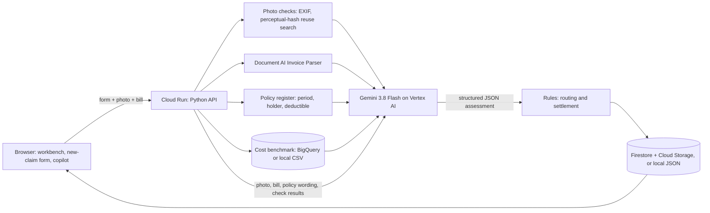

# OmniClaim AI

Insurance claim triage that checks the damage photo against the repair bill, built on Gemini on Vertex AI, Document AI, Firestore and Cloud Run.

A claimant (or an adjuster) uploads a damage photo and a repair bill. OmniClaim:

1. checks the photo itself: camera metadata, and a perceptual-hash search of every earlier claim for a **reused photo**;
2. reads the bill with the **Document AI Invoice Parser** (line items, totals, vendor, invoice number);
3. sends the photo, the bill, the extracted lines and the policy wording to **Gemini on Vertex AI**, which decides whether the photo supports each billed line, marks the damage on the photo, applies the policy clauses and scores the risk, all as structured JSON;
4. applies plain, auditable rules: **auto-approve**, **adjuster review** or **referral to the Special Investigations Unit (SIU)**, and calculates the payment;
5. stores everything in **Firestore** and **Cloud Storage**, and gives the adjuster a workbench with the evidence, the reasons for each decision, a letter that always matches the numbers, and a copilot that answers questions about the claim.

Every Google Cloud service is optional. Without credentials the app runs in **demo mode**; each service switches on with one setting.

---

## Fit with the problem statement

| Suggested direction | What OmniClaim does |
| --- | --- |
| Fraud detection | Finds reused photos across all claims, bills for repairs the photo does not show, photos of a different vehicle than the one claimed, losses days after a policy starts, and amounts far above similar claims. |
| Document intelligence | Document AI extracts the line items, totals and invoice details from bills (image or PDF); Gemini checks each line against the photo. |
| Risk assessment | A 0-100 risk score with written reasons, combined with deterministic routing rules. |
| Compliance automation | Every decision cites the policy clauses it relied on, lists its findings by source, and logs each analysis step with timings. Money is never calculated by the model. |
| Customer interactions | A plain-language letter for the claimant, regenerated after every adjuster decision. |

## Google Cloud services

| Service | Status | Role |
| --- | --- | --- |
| **Gemini on Vertex AI** (`gemini-3.8-flash`) | Used | Multimodal assessment of photo + bill + policy wording with a strict JSON schema; adjuster copilot. Authenticates with the Cloud Run service account, so no API key is involved. |
| **Cloud Run** | Used | Hosts the API and the web app in one container. One-command deploy script in `deploy/`. |
| **Document AI** (Invoice Parser) | Optional, implemented | Reads line items, totals, vendor and invoice number from every bill before Gemini judges them. Without it, Gemini reads the bill on its own. |
| **Firestore** + **Cloud Storage** | Optional, implemented | Durable claim storage that survives redeploys and supports several instances; photos and bills in a bucket. Without it, a local JSON file is used. |
| **BigQuery** | Optional, implemented | Cost benchmark: where the claimed amount falls among similar historical claims. Falls back to the same dataset computed locally. |
| Vertex AI Search | Roadmap | Retrieval over large policy libraries. The sample policy wording is short enough to give to Gemini directly. |
| Pub/Sub | Roadmap | Asynchronous intake at volume. Claims are processed synchronously today. |

The **How it works** dialog in the app shows the live status of each service for the running deployment: active, configured, error (with the reason), or not configured.

## Architecture



Details, including the claim data model and the exact Gemini and Document AI requests, are in [docs/ARCHITECTURE.md](docs/ARCHITECTURE.md).

## Quick start

Requires Python 3.10 or newer (3.12 recommended).

```bash
python -m venv .venv
# Windows:      .venv\Scripts\activate
# macOS/Linux:  source .venv/bin/activate
pip install -r requirements.txt
python server.py
```

Open <http://localhost:8080>. With nothing configured the app runs in demo mode. The sample claims and the four sample scenarios in **New claim** work immediately, and all photo, policy and cost checks run for real.

### Connect Gemini

**Vertex AI (recommended, no API key):**

```bash
gcloud auth application-default login
gcloud services enable aiplatform.googleapis.com --project YOUR_PROJECT_ID
```

Then create a `.env` file (copy `.env.example`) with `GOOGLE_CLOUD_PROJECT=YOUR_PROJECT_ID` and restart, or choose **AI settings > Vertex AI** in the app.

**API key (quick experiments):** in **AI settings** choose **API key** and paste a key from [Google AI Studio](https://aistudio.google.com/app/apikey). It is stored only in `data/runtime/settings.json`, which is git-ignored and never served over HTTP.

Click **Test connection** to confirm that Gemini answers. Document AI, Firestore and BigQuery are configured the same way; see [docs/CONFIGURATION.md](docs/CONFIGURATION.md).

## Deploy to Cloud Run

Minimal deployment (Gemini on Vertex AI):

```bash
PROJECT_ID=your-project ./deploy/deploy-cloud-run.sh
```

With every optional service:

```bash
python tools/create_document_ai_processor.py --project your-project   # prints the processor name
PROJECT_ID=your-project USE_FIRESTORE=true \
  DOCUMENT_AI_PROCESSOR=projects/your-project/locations/us/processors/PROCESSOR_ID \
  BIGQUERY_BENCHMARK_TABLE=your-project.omniclaim.historical_claims \
  ./deploy/deploy-cloud-run.sh
```

```powershell
.\deploy\deploy-cloud-run.ps1 -ProjectId your-project -UseFirestore `
  -DocumentAiProcessor projects/your-project/locations/us/processors/PROCESSOR_ID `
  -BigQueryTable your-project.omniclaim.historical_claims
```

The script enables the APIs and creates a service account with only the roles it needs. With Firestore on, it also creates the Firestore database and the bucket. Then it builds the container and deploys it. Step-by-step instructions, the BigQuery data load and troubleshooting are in [docs/DEPLOYMENT.md](docs/DEPLOYMENT.md).

## Demo scenarios

**New claim** offers four presets. Each fills in the form and attaches a real photo and a sample invoice:

| Scenario | What it shows | Usual outcome |
| --- | --- | --- |
| Inflated repair bill | A paint scrape on a wheel arch, but the bill adds $7,200 of suspension, exhaust and frame work | Adjuster review, $750 payment recommended |
| Storm-damaged windshield | A shattered windshield with a standard glass invoice | Auto-approved |
| Burst pipe (home) | Ceiling water damage with a plumber's invoice | Auto-approved |
| Reused photo | A "2024 BMW M4" claim that uses the photo from two earlier claims | SIU referral |

The six sample claims in the queue are labeled **Sample scenario**. Their AI assessment is pre-recorded, but their photo, policy and cost checks run live at start-up. For example, the reused photo in CLM-9104 is found by the real perceptual-hash search. A 3-minute demo script is in [docs/DEMO_GUIDE.md](docs/DEMO_GUIDE.md).

## How decisions are made

- **Auto-approve:** risk 0-19, coverage confirmed, a damage photo and an itemized bill with every line supported, no findings that need review, and a successful AI assessment.
- **SIU referral:** risk 80 or higher, or a photo or document already used in another claim.
- **Adjuster review:** everything else, with a recommended amount and the reasons.
- **Payment** = approved amount minus the deductible, never below zero. Nothing is paid while a claim is with SIU or denied.

Gemini provides the evidence and the risk score. The routing and every number are computed in [`omniclaim/adjudication.py`](omniclaim/adjudication.py).

## Tests

```bash
python -m unittest discover -s tests
```

90 tests. They run in about 15 seconds without network access. They test the real Google client libraries against local fake endpoints and official emulators:

- **Gemini:** the `google-genai` SDK against a fake Gemini endpoint. These tests check the exact request (photo and bill parts, JSON schema, thinking level) and the error handling, in Vertex AI and API-key mode.
- **Document AI:** the `google-cloud-documentai` REST client against a fake Document AI endpoint. They cover request, parsing, failures and the processor tool.
- **Firestore and Cloud Storage:** the store against the official Firestore emulator and a Cloud Storage emulator. They cover the full pipeline, unique claim numbers across instances, single seeding and reset. These 4 tests are skipped unless the emulators are running; see [docs/TESTING.md](docs/TESTING.md).
- **BigQuery:** the query, its parameters, and the fallback.
- **The rest:** photo checks, decision and payment rules, the pipeline, input validation, the HTTP layer and its security rules.

## Project structure

```
server.py               Entry point: python server.py
omniclaim/              Backend package
  ai.py                 Gemini client (Vertex AI or API key), status, error messages
  docai.py              Document AI Invoice Parser client and parser
  schemas.py            JSON schema Gemini must answer in
  prompts.py            Assessment and copilot prompts
  imaging.py            Photo validation, EXIF metadata, perceptual hash
  checks.py             Reused photo/document, metadata, policy period, cost checks
  benchmarks.py         Cost benchmark (local dataset or BigQuery)
  adjudication.py       Routing, settlement, decisions, claimant letter
  service.py            Claim pipeline and operations
  store.py              Local claim storage (JSON file with atomic writes)
  cloud_store.py        Firestore + Cloud Storage claim storage
  web.py                HTTP API and static files
  config.py             Settings and decision thresholds
index.html, app.js, styles.css   Web app (no build step)
data/                   Policy wording and register, seed claims, benchmark dataset
samples/                Sample photos, invoices and presets (see samples/ATTRIBUTION.md)
tests/                  Unit and integration tests
deploy/                 Cloud Run deploy scripts (Bash and PowerShell)
tools/                  Sample invoices, benchmark dataset, Document AI processor setup
docs/                   Architecture, configuration, deployment, API, testing, demo guide, security
```

## Documentation

| Document | Contents |
| --- | --- |
| [docs/ARCHITECTURE.md](docs/ARCHITECTURE.md) | Components, request flow, the Gemini and Document AI requests, decision rules, data model, storage, security design, roadmap |
| [docs/CONFIGURATION.md](docs/CONFIGURATION.md) | Every environment variable and setting |
| [docs/DEPLOYMENT.md](docs/DEPLOYMENT.md) | Cloud Run deployment, Document AI, Firestore and BigQuery setup, verification, troubleshooting |
| [docs/API.md](docs/API.md) | HTTP API reference with examples |
| [docs/TESTING.md](docs/TESTING.md) | Running the tests, including the Firestore and Cloud Storage emulators |
| [docs/DEMO_GUIDE.md](docs/DEMO_GUIDE.md) | 3-minute demo script and answers to likely questions |
| [docs/SECURITY.md](docs/SECURITY.md) | Revoking the old key, how secrets are handled, IAM roles, protections |
| [docs/SUBMISSION_CHECKLIST.md](docs/SUBMISSION_CHECKLIST.md) | What to update in the deck, links and video before submitting |
| [CHANGELOG.md](CHANGELOG.md) | What changed in each version |

## Limitations

- Sample claims, policy wording and the 10,000-row benchmark dataset are fictional or synthetic and labeled as such in the app.
- The reused-photo search covers claims in this deployment only. External sources such as salvage auctions or industry fraud databases are not connected.
- Without `CLAIMS_STORE=firestore`, claims are kept in a local JSON file, which resets on every Cloud Run deploy.
- Gemini can be wrong. That is why a human decides every claim that is not low-risk and fully supported.

## Security

No API keys are stored in this repository. An API key that was committed in an earlier version must be revoked; see [docs/SECURITY.md](docs/SECURITY.md).

## Team

Daniel Ahmed (lead), Bikash Nath, Md Sibgatullah.

Sample photos are from Wikimedia Commons under CC BY 2.0 and CC0; see [samples/ATTRIBUTION.md](samples/ATTRIBUTION.md).
